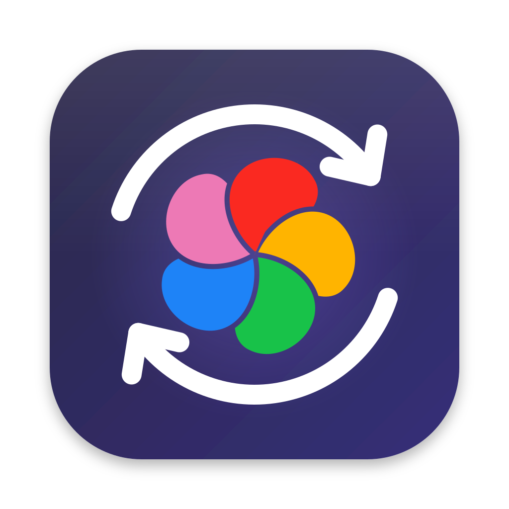
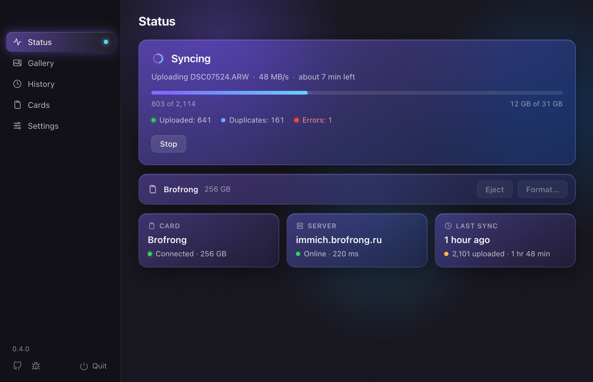
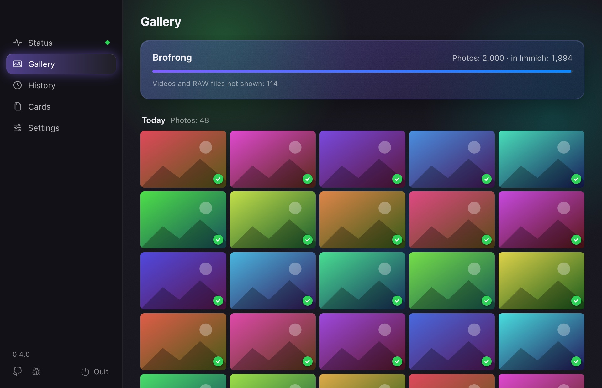

<p align="center">
  
</p>

<h1 align="center">SD Sync Immich</h1>

<p align="center"><b>Insert the SD card, the photos go to <a href="https://immich.app">Immich</a>.</b></p>

<p align="center">
  <a href="https://brofrong.github.io/sd-sync-immich/"><b>Website</b></a> ·
  <a href="https://brofrong.github.io/sd-sync-immich/downloads/"><b>Download</b></a> ·
  English · <a href="README.ru.md">Русский</a>
</p>

<p align="center">
  <a href="https://github.com/brofrong/sd-sync-immich/releases/latest"></a>
  <a href="https://github.com/brofrong/sd-sync-immich/releases"></a>
  <a href="https://github.com/brofrong/sd-sync-immich/actions/workflows/ci.yml"></a>
  
  <a href="LICENSE"></a>
</p>

A small app in the menu bar (the tray on Windows and Linux). It notices
your camera's card by itself and uploads only the new shots to Immich. No
more remembering which photo from the card you uploaded last.

**[Download for your system →](https://brofrong.github.io/sd-sync-immich/)**
macOS 13+, Windows 10/11 and Linux x86_64 (Windows and Linux are betas).
Needs an Immich v3 server. Free and open source.



## What it does

- **Uploads by itself.** Insert the card and the upload starts. Nothing to
  click.
- **Remembers what is uploaded.** Each card has its own progress: next time
  only the new shots go up.
- **A gallery right from the card.** Photos by day, newest first, each
  marked: in Immich, uploading, waiting or failed. Click a photo to see it
  large and flip through with the arrow keys. Handy for showing the shoot
  while it is still uploading.
- **No duplicates.** Checks the file date and checksum, as
  [immich-go](https://github.com/simulot/immich-go) does.
- **Survives interruptions.** Network gone or the server down? The app stops
  and picks up where it left off when Immich is back.
- **Photos, RAW and video.** Everything Immich takes, with XMP sidecars,
  several files at once. Finds the shots on cards from Canon, Nikon, Sony,
  Fujifilm, Panasonic, Olympus, GoPro, DJI and other cameras.
- **RAW+JPEG as one photo.** A RAW and the JPEG or HEIF shot with it are
  stacked in Immich, the JPEG on top. Can be turned off in Settings.
- **Card ready to go.** After the upload the card is ejected, so you can
  take it out. If you like, the app also formats it, but only after checking
  that every file is in Immich.
- **History.** When and how much was uploaded, and what failed; failed files
  can be uploaded again with one click.
- **Notifications** when an upload is done, when the server has a problem
  or when another card is inserted. Each kind can be turned on separately.
- **Stays out of the way.** Can start at login and updates itself.
- **8 languages:** English, Russian, German, Spanish, French, Portuguese,
  Chinese and Japanese.



## How it differs from other ways to upload

- **The Immich mobile app** backs up the photos on your phone. SD Sync
  Immich is for the camera's card: no need to copy the shots to the phone
  or the computer first.
- **[immich-go](https://github.com/simulot/immich-go) and the
  [Immich CLI](https://docs.immich.app/features/command-line-interface)** are
  command-line tools: you run them and point them at a folder. They are great
  for big imports such as a Google Photos takeout. SD Sync Immich is for
  the everyday card after a shoot: it notices the card, uploads only what is
  new on it, and ejects it when done.

## Privacy

The app talks to your Immich server and to GitHub, to check for a new
version and download it. No accounts. The API key stays on your computer
and is only sent to your server.

Anonymous statistics are off until you allow them: the app asks once, and
**Settings → Statistics** turns them on or off. When on, it sends the app's
version and system, how many files each upload had and the errors it ran
into, with a random id that changes each time you turn them on. Never file
names, paths, the server's address or the API key. Details are in
[SECURITY.md](SECURITY.md).

## How it is made

Most of the code, tests and texts are written with AI (Claude, through
Claude Code); the commits that it co-wrote say so. I decide what the app
does and how, and I use it myself: on macOS with my camera's cards since
July 2026. Every change runs the automated tests on macOS, Windows and
Linux; the tests use fake servers and temporary folders, never real cards
or disks. The Windows and Linux builds have been tried by hand much less,
which is why they are betas. If something breaks on your system,
[please tell me](https://github.com/brofrong/sd-sync-immich/issues/new/choose).

## Installing

The easiest way is the [download page](https://brofrong.github.io/sd-sync-immich/):
it offers the file for your system. All files are on the
[Releases](https://github.com/brofrong/sd-sync-immich/releases/latest) page.

### macOS

1. Download **`SD-Sync-Immich.dmg`**, open it and drag **SD Sync Immich**
   onto the **Applications** folder.
2. The app is not signed with an Apple Developer ID, so macOS blocks the
   first launch. Open **System Settings → Privacy & Security** and click
   **Open Anyway** next to SD Sync Immich. Or in Terminal:

   ```bash
   xattr -dr com.apple.quarantine /Applications/"SD Sync Immich.app"
   ```

Or with [Homebrew](https://brew.sh) instead of step 1 (step 2 is the same):

```bash
brew tap brofrong/tap
brew trust --cask brofrong/tap/sd-sync-immich
brew install --cask sd-sync-immich
```

### Windows (beta)

1. Download and run **`SD-Sync-Immich-Setup-x64.exe`**. No administrator
   rights needed.
2. The installer is not signed, so SmartScreen warns about it: click
   **More info → Run anyway**. Edge may also say while downloading that the
   file "isn't commonly downloaded": **…** → **Keep**.

The app lives in the tray (the icon may be hidden under the "^" arrow on
the taskbar).

### Linux (beta)

1. Download **`SD-Sync-Immich-x86_64.AppImage`**, put it where it will live
   (for example `~/Applications`) and run it:

   ```bash
   chmod +x SD-Sync-Immich-x86_64.AppImage
   ./SD-Sync-Immich-x86_64.AppImage
   ```

2. If the AppImage complains about FUSE, install the `fuse3` (or `fuse`)
   package.

Or a Flatpak instead of the AppImage: download
**`SD-Sync-Immich-x86_64.flatpak`** and install it:

```bash
flatpak install --user SD-Sync-Immich-x86_64.flatpak
```

The app shows up in the applications menu. The Flatpak does not update
itself: download the new version and install it the same way.

Ubuntu 22.04, Debian 12, Fedora 36 and newer work. On GNOME the tray icon
needs the
[AppIndicator](https://extensions.gnome.org/extension/615/appindicator-support/)
extension (Ubuntu has it); KDE and other desktops show the tray themselves.

## First launch

1. Open the app's window: in the menu bar → **Open SD Sync Immich** (on
   Windows and Linux, click the tray icon).
2. **Settings → Server:** your Immich address (for example
   `https://immich.example.com`) and an API key. Create the key in Immich:
   **Account Settings → API Keys → New API Key**, with the `asset.upload`
   and `stack.create` permissions (the second one stacks RAW+JPEG pairs).
   Click **Test Connection** and **Save**.
3. Insert the card → **Cards** → **Select**.
4. That's it. From now on the upload starts by itself when the card is
   inserted.

To keep the app running all the time, turn on **Settings → Open at Login**.

## The card after the upload

**Settings → Card** has two switches:

- **Eject the card after uploading** (on). When everything is uploaded
  without errors, the card is ejected and can be taken out.
- **Format the card after uploading** (off). The app checks that every
  photo and video on the card is in Immich, waits 30 seconds (you can
  cancel) and formats the card. If even one file is not found, the card is
  left alone and the app says why.

> **Warning:** formatting erases **everything** on the card, not just the
> photos and videos. Photos in the Immich trash do not count as uploaded.

On Windows the system does not let the app format a card without
administrator rights, and on Linux when it asks for a password; then the
app just says so, and you can format the card in the camera.

## If something goes wrong

The log opens in the window: **Settings → Open Log**. The settings and log
files are here:

| | Settings and history | Log (`app.log`) |
|---|---|---|
| macOS | `~/.config/sd-sync-immich` | `~/Library/Logs/sd-sync-immich` |
| Windows | `%APPDATA%\sd-sync-immich` | `%LOCALAPPDATA%\sd-sync-immich\logs` |
| Linux | `~/.config/sd-sync-immich` | `~/.local/state/sd-sync-immich` |
| Linux, Flatpak | `~/.var/app/io.github.brofrong.sd-sync-immich/config/sd-sync-immich` | `~/.var/app/io.github.brofrong.sd-sync-immich/.local/state/sd-sync-immich` |

Uninstalling the app leaves these folders. To uninstall: on macOS drag the
app to the Trash, on Windows use **Settings → Apps**, on Linux delete the
AppImage or run `flatpak uninstall io.github.brofrong.sd-sync-immich`.

Found a bug? [Open an issue](https://github.com/brofrong/sd-sync-immich/issues/new/choose)
with your system, what you did and what happened, and attach `app.log`.
Questions and ideas are welcome in [Discussions](https://github.com/brofrong/sd-sync-immich/discussions).

## Contributing

Issues and pull requests are welcome. How to build the app and try the
window in a browser is in [CONTRIBUTING.md](CONTRIBUTING.md).

## License

[MIT](LICENSE): free to use, change and share, including commercially, as
long as the copyright notice stays.

Not affiliated with the Immich team.
