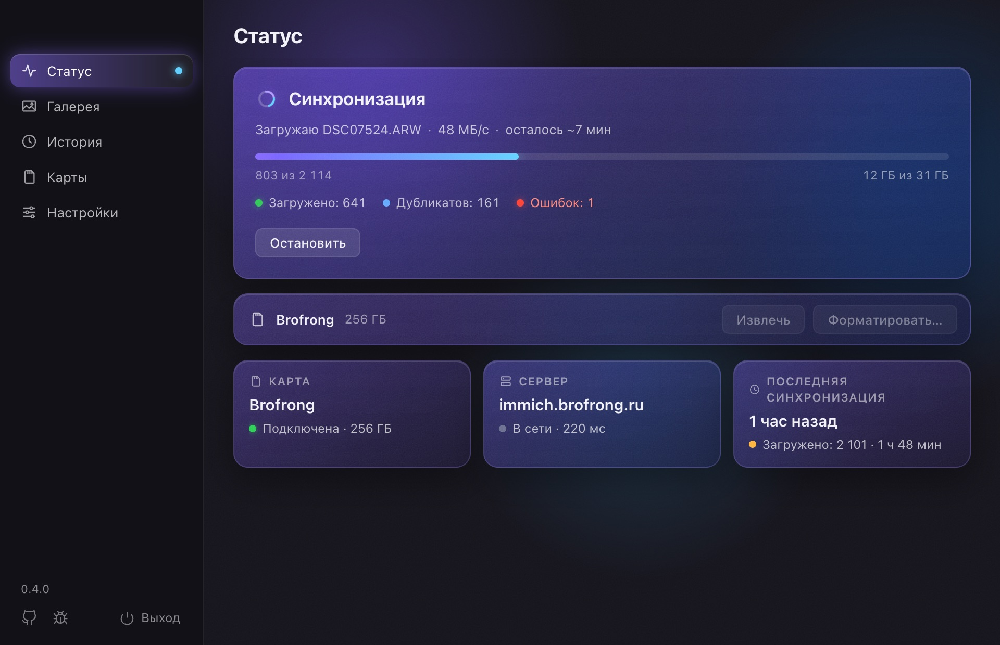
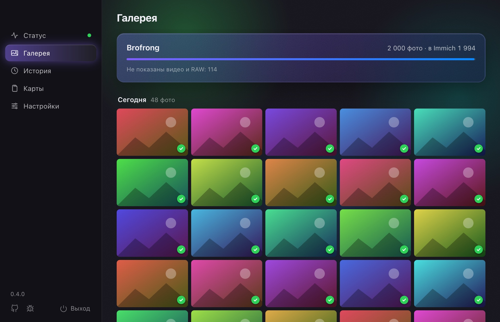

# SD Sync Immich

[English](README.md) · **Русский**

Вставил SD-карту — фото уже в [Immich](https://immich.app).

Маленькое приложение в menu bar (на Windows и Linux — в трее). Оно само
замечает карту фотоаппарата и загружает в Immich только новые снимки. Больше
не нужно вспоминать, какое фото с карты было загружено последним.

**[Скачать для своей системы →](https://brofrong.github.io/sd-sync-iimich/)**
macOS 13+, Windows 10/11 и Linux x86_64 (Windows и Linux — бета). Нужен
сервер Immich v3. Бесплатно, открытый код.



## Что умеет

- **Загружает само.** Вставили карту — загрузка началась. Ничего не нужно
  нажимать.
- **Помнит, что уже загружено.** У каждой карты свой прогресс: в следующий раз
  уходят только новые снимки.
- **Галерея прямо с карты.** Фото по дням, новые сверху, у каждого отметка: в
  Immich, загружается, ждёт или ошибка. По клику фото открывается крупно,
  листать — стрелками. Удобно, чтобы показать съёмку, пока она ещё грузится.
- **Без дублей.** Сверяет дату файла и контрольную сумму, как
  [immich-go](https://github.com/simulot/immich-go).
- **Переживает обрывы.** Пропала сеть или сервер недоступен — приложение
  остановится и продолжит с того же места, когда Immich снова на связи.
- **Фото, RAW и видео.** Всё, что принимает Immich, вместе с XMP-файлами, в
  несколько потоков. Само находит снимки на картах Canon, Nikon, Sony,
  Fujifilm, Panasonic, Olympus, GoPro, DJI и других камер.
- **Карта сразу готова.** После загрузки карта извлекается — её можно
  вынимать. По желанию приложение её ещё и отформатирует, но только когда
  проверит, что каждый файл есть в Immich.
- **История.** Видно, когда и сколько загружено и что не получилось; файлы с
  ошибками можно загрузить ещё раз одной кнопкой.
- **Уведомления** о том, что загрузка закончилась, о проблемах с сервером или о
  том, что вставлена другая карта. Каждый вид включается отдельно.
- **Не мешает.** Может запускаться при входе в систему и обновляется само.
- **8 языков:** русский, английский, немецкий, испанский, французский,
  португальский, китайский и японский.



## Чем отличается от других способов загрузки

- **Мобильное приложение Immich** сохраняет фото с телефона. SD Sync Immich —
  для карты фотоаппарата: не нужно сначала копировать снимки на телефон или
  компьютер.
- **[immich-go](https://github.com/simulot/immich-go) и
  [Immich CLI](https://docs.immich.app/features/command-line-interface)** —
  программы для командной строки: их запускают вручную и указывают папку.
  Они отлично подходят для больших импортов, например архива из Google
  Фото. SD Sync Immich — для обычной карты после съёмки: сам замечает карту,
  загружает с неё только новое и извлекает, когда всё готово.

## Приватность

Приложение общается только с вашим сервером Immich и с GitHub — чтобы
проверить и скачать новую версию. Никакой аналитики и аккаунтов. Ключ API
хранится на вашем компьютере и отправляется только на ваш сервер. Подробнее —
в [SECURITY.md](SECURITY.md).

## Установка

Самый простой путь — [страница загрузки](https://brofrong.github.io/sd-sync-iimich/):
она сама предложит файл для вашей системы. Все файлы — на странице
[Releases](https://github.com/brofrong/sd-sync-iimich/releases/latest).

### macOS

1. Скачайте **`SD-Sync-Immich.dmg`**, откройте его и перетащите
   **SD Sync Immich** на папку **Applications**.
2. Приложение не подписано Apple Developer ID, поэтому первый запуск macOS
   заблокирует. Откройте **Системные настройки → Конфиденциальность и
   безопасность** и нажмите **Всё равно открыть** у SD Sync Immich. Или в
   Терминале:

   ```bash
   xattr -dr com.apple.quarantine /Applications/"SD Sync Immich.app"
   ```

### Windows (бета)

1. Скачайте и запустите **`SD-Sync-Immich-Setup-x64.exe`**. Права
   администратора не нужны.
2. Установщик не подписан, поэтому SmartScreen предупредит о нём: нажмите
   **Подробнее → Выполнить в любом случае**. Edge может ещё при скачивании
   сказать, что файл «скачивают нечасто»: **…** → **Сохранить**.

Приложение живёт в трее (значок может быть спрятан под стрелкой «^» на панели
задач).

### Linux (бета)

1. Скачайте **`SD-Sync-Immich-x86_64.AppImage`**, положите туда, где он будет
   жить (например, в `~/Applications`), и запустите:

   ```bash
   chmod +x SD-Sync-Immich-x86_64.AppImage
   ./SD-Sync-Immich-x86_64.AppImage
   ```

2. Если AppImage ругается на FUSE, установите пакет `fuse3` (или `fuse`).

Подходят Ubuntu 22.04, Debian 12, Fedora 36 и новее. В GNOME для значка в трее
нужно расширение
[AppIndicator](https://extensions.gnome.org/extension/615/appindicator-support/)
(в Ubuntu оно уже есть); KDE и другие рабочие столы показывают трей сами.

## Первый запуск

1. Откройте окно приложения: в menu bar → **Открыть SD Sync Immich** (на
   Windows и Linux — кликом по значку в трее).
2. **Настройки → Сервер:** адрес вашего Immich (например,
   `https://immich.example.com`) и ключ API. Ключ создаётся в Immich:
   **Account Settings → API Keys → New API Key**, с правом `asset.upload`.
   Нажмите **Проверить подключение** и **Сохранить**.
3. Вставьте карту → раздел **Карты** → **Выбрать**.
4. Всё. Дальше загрузка начинается сама, как только карта вставлена.

Если хотите, чтобы приложение работало всегда, включите **Настройки →
Автозапуск**.

## Карта после загрузки

В **Настройках → Карта** два переключателя:

- **Извлекать карту после загрузки** (включено). Когда всё загрузилось без
  ошибок, карта извлекается — можно вынимать.
- **Форматировать карту после загрузки** (выключено). Приложение проверяет,
  что каждое фото и видео с карты есть в Immich, ждёт 30 секунд (можно
  отменить) и форматирует карту. Если хоть один файл не найден, карта не
  трогается, а приложение пишет почему.

> **Внимание:** форматирование стирает с карты **всё**, не только фото и
> видео. Фото, лежащие в корзине Immich, загруженными не считаются.

На Windows форматировать карту без прав администратора система не даёт, а на
Linux — если просит пароль; тогда приложение просто сообщит об этом, и карту
можно отформатировать в камере.

## Если что-то не так

Журнал работы открывается в окне: **Настройки → Открыть журнал**. Файлы
настроек и журнала:

| | Настройки и история | Журнал (`app.log`) |
|---|---|---|
| macOS | `~/.config/sd-sync-immich` | `~/Library/Logs/sd-sync-immich` |
| Windows | `%APPDATA%\sd-sync-immich` | `%LOCALAPPDATA%\sd-sync-immich\logs` |
| Linux | `~/.config/sd-sync-immich` | `~/.local/state/sd-sync-immich` |

Удаление приложения эти папки не трогает. Удалить приложение: на macOS —
перетащить в Корзину, на Windows — **Параметры → Приложения**, на Linux —
удалить AppImage.

Нашли ошибку? Создайте [issue](https://github.com/brofrong/sd-sync-iimich/issues/new/choose):
напишите систему, что делали и что произошло, и приложите `app.log`.

## Участие

Issues и pull requests приветствуются, можно по-русски. С чего начать — в
[CONTRIBUTING.md](CONTRIBUTING.md) (на английском); как собрать приложение,
команды для командной строки и как устроены релизы — в
[docs/DEVELOPMENT.md](docs/DEVELOPMENT.md).

## Лицензия

[MIT](LICENSE): можно свободно использовать, менять и распространять, в том
числе в коммерческих целях, сохраняя уведомление об авторских правах.

Проект не связан с командой Immich.
